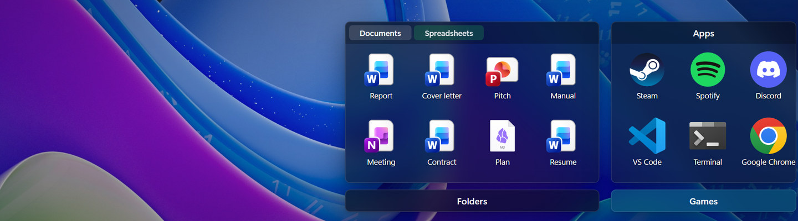
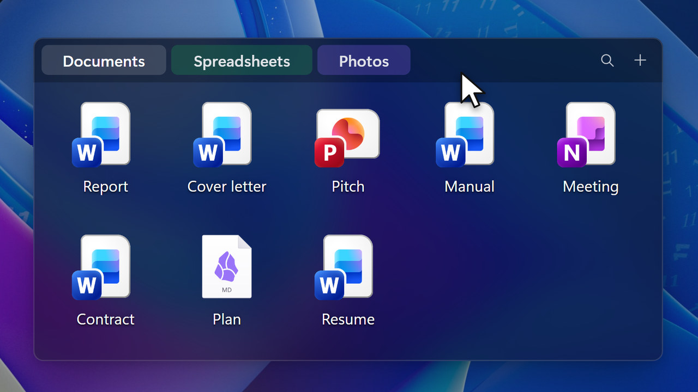
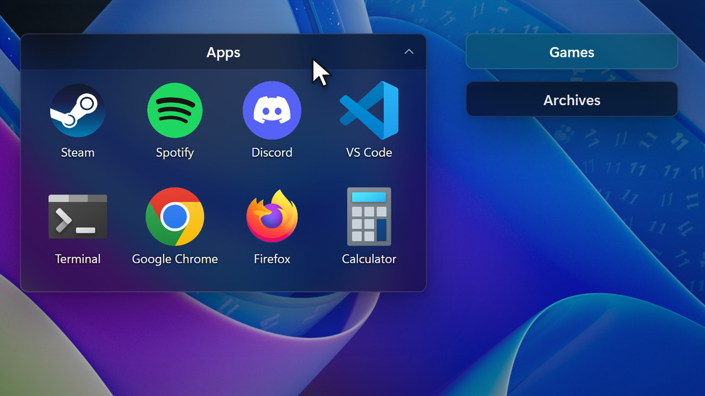
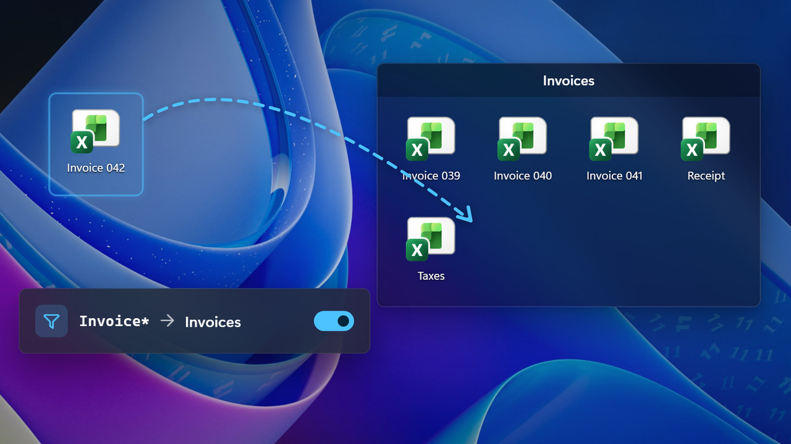
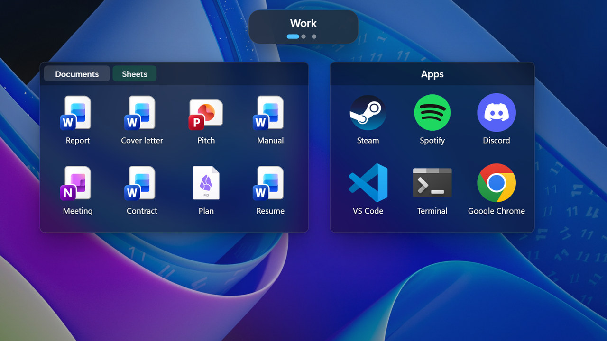
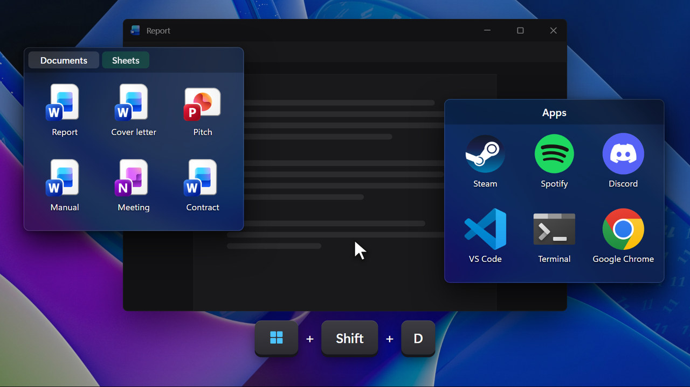
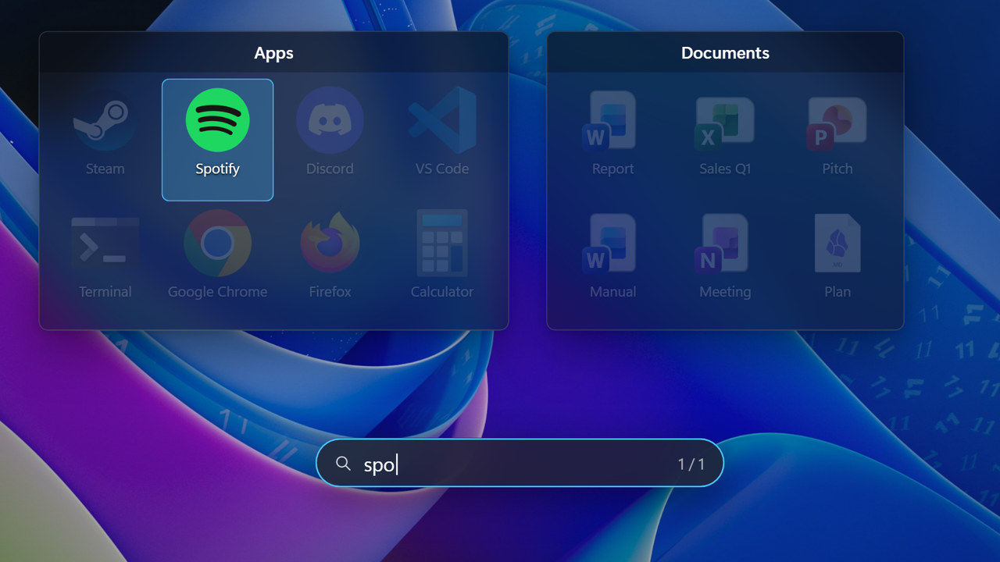
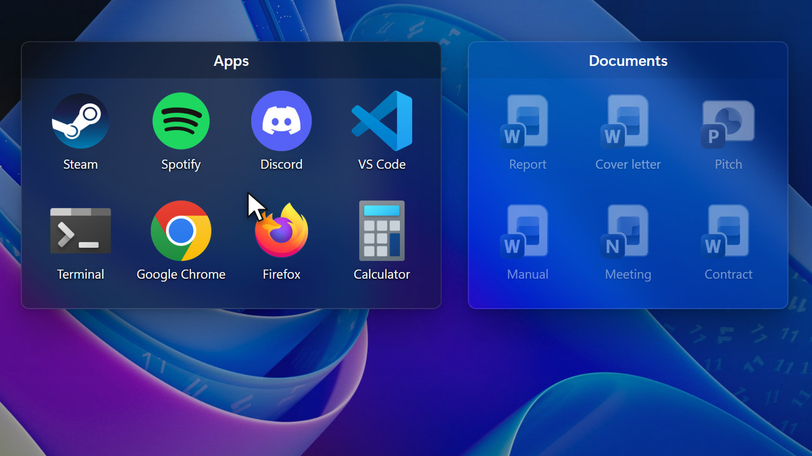
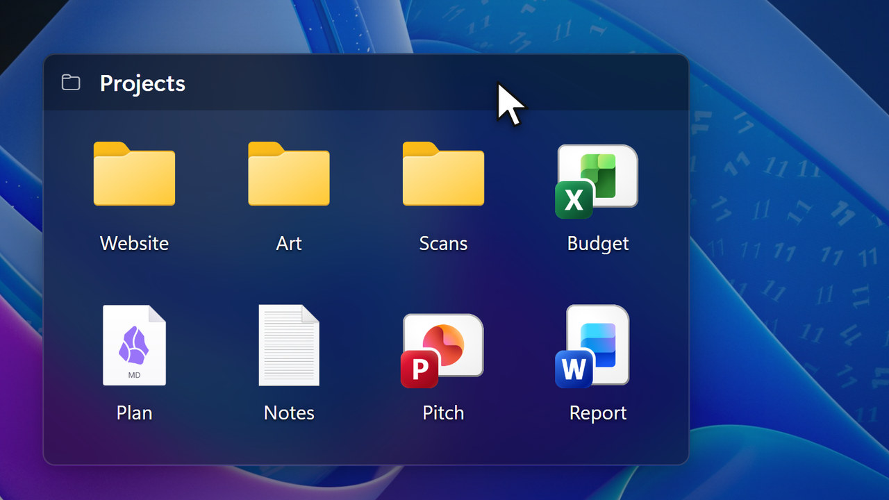

# Deskboxes

<p align="center">
<picture><source media="(prefers-color-scheme: light)" srcset="images/home_l.jpg"></picture>
</p>

Deskboxes is a desktop organizer for Windows 11. It groups your desktop icons into boxes that you
can move, resize, roll up, tab and color, so the desktop stays tidy and things stay easy to find.

Deskboxes only arranges how icons are shown. Your files stay where they are, in the Desktop
folder, and Explorer, the Recycle Bin and every other program see them exactly as before.

**[Download the latest version](https://github.com/deskboxes/releases/releases/latest)** (DeskboxesSetup.exe).
Installed copies update themselves.

## Features

- **Boxes.** Group icons into boxes. You can move, resize and snap boxes to screen edges, and give each one its own color, transparency and background blur.
- **Tabs.** Keep several groups of icons in one box and switch between them from the title bar.
- **Roll-up.** Fold a box down to its title. It opens when you point at it, click it or double-click its title.
- **Sorting rules.** New icons go into the right box by themselves, by file type, name or date.
- **A–Z index.** Keep a box in name order with a letter bar for jumping to a letter.
- **Folder boxes.** Show a folder's files in a box, and open its subfolders right there.
- **Desktop pages.** Keep more desktops side by side, each with its own boxes and icons. Switch pages with Alt+Left and Alt+Right, a touchpad swipe or by dragging the desktop.
- **Boxes above windows.** Bring your boxes up above the open windows with a shortcut or a screen corner. No window gets minimized.
- **Search.** Start typing on the desktop, or press Ctrl+F, to find any icon, whether loose or in a box.
- **Hide all.** Double-click an empty spot to show only the wallpaper.
- **Icon looks.** Tint icons, or let them blend into the wallpaper until you point at them.
- **Saved layouts.** Save how your boxes are arranged and return to that later, or to how they were on any of the last seven days.
- **Locks.** Stop boxes and icons from being moved or resized by accident.
- **Privacy mode.** Hide icon names when someone is looking.
- **Undo.** Ctrl+Z undoes layout changes and file moves, deletes, copies and renames. Ctrl+Y redoes them.
- **Windows context menus.** Right-clicking an icon or the desktop shows Windows' own menu, including the commands other apps add to it, plus Deskboxes' own commands.
- **English and Polish**, following the Windows display language.

## A closer look

<table>
<tr><td width="50%"><picture><source media="(prefers-color-scheme: light)" srcset="images/tabs_l.jpg"></picture><br><b>Tabs</b><br>Several groups of icons in one box.</td><td width="50%"><picture><source media="(prefers-color-scheme: light)" srcset="images/rollup_l.jpg"></picture><br><b>Roll-up</b><br>Fold a box down to its title; it opens when you point at it.</td></tr>
<tr><td width="50%"><picture><source media="(prefers-color-scheme: light)" srcset="images/rules_l.jpg"></picture><br><b>Sorting rules</b><br>New icons go to the right box by themselves.</td><td width="50%"><picture><source media="(prefers-color-scheme: light)" srcset="images/pages_l.jpg"></picture><br><b>Desktop pages</b><br>More desktops side by side, each with its own boxes.</td></tr>
<tr><td width="50%"><picture><source media="(prefers-color-scheme: light)" srcset="images/above_l.jpg"></picture><br><b>Boxes above windows</b><br>Your boxes over the open windows, with a shortcut.</td><td width="50%"><picture><source media="(prefers-color-scheme: light)" srcset="images/search_l.jpg"></picture><br><b>Search</b><br>Start typing on the desktop to find any icon.</td></tr>
<tr><td width="50%"><picture><source media="(prefers-color-scheme: light)" srcset="images/blend_l.jpg"></picture><br><b>Blend into wallpaper</b><br>Icons take the wallpaper's colors until you point at them.</td><td width="50%"><picture><source media="(prefers-color-scheme: light)" srcset="images/folder_l.jpg"></picture><br><b>Folder boxes</b><br>A folder's files in a box, with its subfolders right there.</td></tr>
</table>

Settings has a short clip of each feature.

## Requirements

- Windows 11, 64-bit.
- A GPU with Direct3D 11. Without one, Deskboxes uses Windows' software renderer.

## Install and uninstall

1. Download `DeskboxesSetup.exe` from the [latest release](https://github.com/deskboxes/releases/releases/latest).
2. Run it. It installs for the current user only, in `%LOCALAPPDATA%\Programs\Deskboxes`, and doesn't need administrator rights.

Deskboxes starts when you sign in. To turn it off, right-click the desktop › Deskboxes › Turn off. To turn it back on, right-click the desktop › Turn on Deskboxes.

To uninstall, go to Settings › Apps › Installed apps › Deskboxes. Windows' own desktop icons come back as they were.

If Deskboxes ever leaves the desktop without icons, this command brings Windows' own icons back:

```powershell
& "$env:LOCALAPPDATA\Programs\Deskboxes\deskboxes.exe" --restore-icons
```

## Data and privacy

| What | Where |
| --- | --- |
| Settings, box layouts, saved layouts | `%APPDATA%\Deskboxes` |
| Icon cache and logs | `%LOCALAPPDATA%\Deskboxes` |

Deskboxes makes one network request: a daily update check against this repository's releases. You can turn it off in Settings › Updates. Nothing about your desktop, files or usage
is sent anywhere.

## Third-party components

Deskboxes uses open-source components under the MIT, Apache-2.0 and similar permissive licenses. No copyleft components are used.
